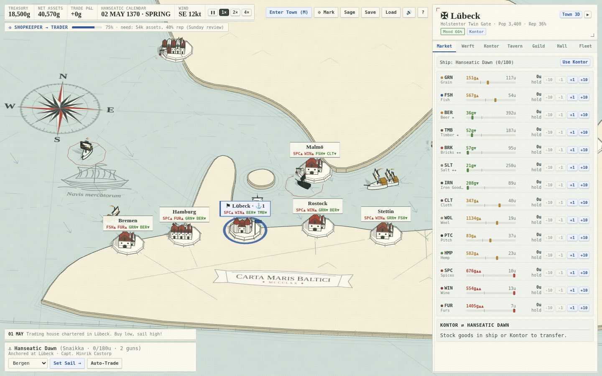
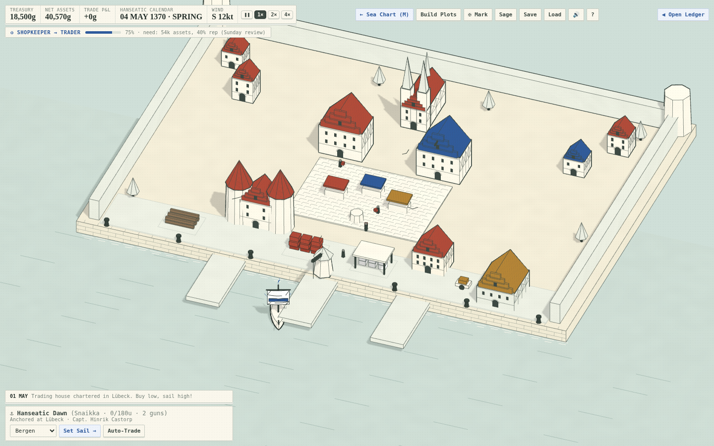

# Hanseatic Ledger · Rise of the Hanse

A trading sim of the Baltic in 1370. Buy low, sail high, build your Kontor and rise from shopkeeper to Hanse trader. Runs in the browser, no install.

### [▶ Play now](https://unrealumanga.github.io/patrician-hanse/)




## Features
- Hand-inked sea chart: Lübeck, Hamburg, Bremen, Rostock, Stettin, Malmö and more
- Live markets for 14 goods with shifting prices, wind and seasons
- Ships, a Werft, Kontor, Tavern, Guild and Hall in every town
- Isometric 3D town view
- Auto-trade, save/load, 1x/2x/4x time

## Run locally
```
npm install
npm run dev
```
